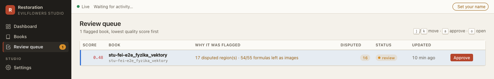
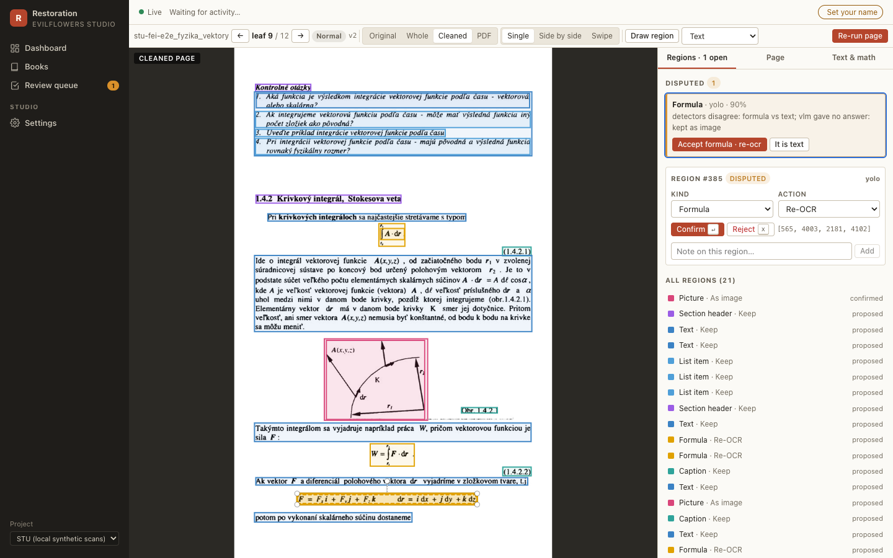
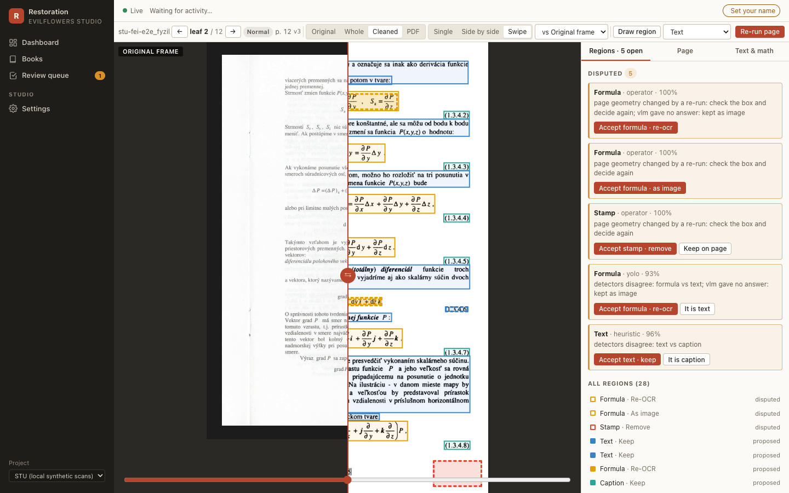

[evilflowers-books-digitalizer](https://github.com/EvilFlowersCatalog/evilflowers-books-digitalizer)
turns scans of printed books into files a reader can search and an archive can
keep, and publishes them to the catalog. It has no tagged release yet; the
code and its
[documentation](https://evilflowerscatalog.github.io/evilflowers-books-digitalizer/)
are public.

<!-- truncate -->

## Why a studio and not just a batch job

The project started as an unattended batch pipeline: scans in, PDFs out. On a
set of 880 scanned university books it gets most pages right and some badly
wrong. A stamp covers a paragraph, a formula is read as prose, a crop loses a
column. A batch job can only rerun everything. The studio lets a person fix one
region on one page, rerun that page in seconds, and approve the book.

<Diagram
  name="activity-digitalizer"
  alt="Activity diagram: TIFF scans are split and cleaned with ScanTailor, OCR'd with Tesseract and analysed for layout and formulas. A quality gate approves the book automatically or sends it to a review queue, where an operator fixes regions and re-runs pages. Then the PDF, PDF/A-2b master and EPUB are rendered and the book is published to the catalog."
/>

## What it does with each book

1. Splits two-page spreads, then crops, deskews and cleans each page with
   ScanTailor.
2. Runs Slovak OCR with Tesseract and finds layout regions: text, headings,
   pictures, captions, formulas.
3. Scores the book: OCR confidence, regions the detectors disagree on, formulas
   it could not read, missing pages. A book that scores well is approved; the
   rest wait in a review queue.
4. Renders three files: a distribution PDF that opens fast in any viewer, a
   PDF/A-2b master for preservation, and a reflowable EPUB.
5. Publishes the book to the catalog through its REST API. Publishing again
   updates the same entry.

The output folder of every book is also a valid Internet Archive item, so the
standard Internet Archive tools work on it directly.

## The review screens

Only books the gate flagged need a person. The review queue lists them with the
reason, lowest score first.

In the page studio, regions are drawn over the cleaned page, coloured by kind.
Where two detectors disagree, for example formula against text, the operator
decides with one click and can re-run OCR on that region.

A swipe compares the original scan with the cleaned page, so a bad crop or a
lost column is easy to spot.

## Status

The digitalizer has not been released yet. When it has a first release, it will
be announced here and listed on the [releases page](/releases). Until then, the
[repository](https://github.com/EvilFlowersCatalog/evilflowers-books-digitalizer)
has setup instructions for the studio and for the batch command line.
