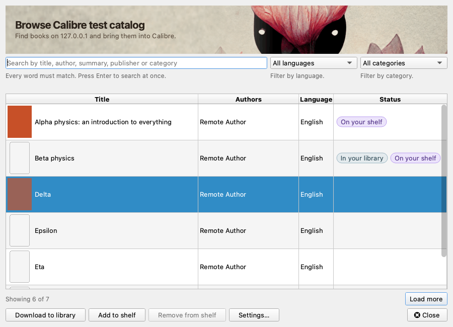
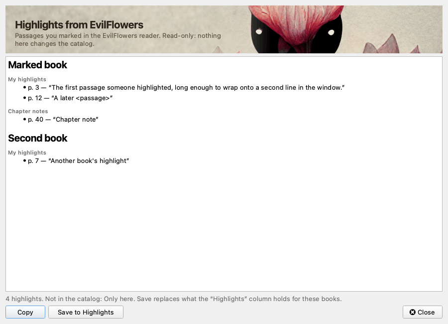

import syncPlan from './sync-plan-conflict-light.png';
import syncPlanDark from './sync-plan-conflict-dark.png';

[calibre-evilflowers 2.1.0](https://github.com/EvilFlowersCatalog/calibre-evilflowers/releases/tag/2.1.0)
is a [Calibre](https://calibre-ebook.com/) plugin that keeps a Calibre library
in sync with a catalog on an EvilFlowers server, such as ELVIRA. Books new in
Calibre are uploaded, books new in the catalog are downloaded, and a change on
one side is applied to the other. Point several computers at the same catalog
and they share one library.

<!-- truncate -->

## Before anything changes, you see the plan

Clicking the toolbar button compares the library with the catalog and lists
every book with what the plugin will do: upload, download or skip. You can
change any row. When a book was edited on both sides, the plugin does not guess:
it shows the two versions field by field and you pick one.

<Figure
  src={syncPlan}
  dark={syncPlanDark}
  alt="The sync window: seven books grouped as to upload, to download, needs a decision and in sync, with a side-by-side comparison of a book changed in both Calibre and the catalog">
  Each row is coloured by what will happen to the book. The panel on the right
  compares the two versions of a book that changed on both sides.
</Figure>

What travels: title, authors, language, tags (as categories), comments (as the
summary), publisher, publication date, identifiers such as ISBN and DOI, the
cover, and EPUB, PDF and MOBI files. Series, ratings and custom columns stay in
Calibre and a download never overwrites them.

**Nothing is ever deleted, on either side.** A book removed in Calibre is not
downloaded again as new, and it is not removed from the catalog either. The
plugin only ever removes files it uploaded itself, when it replaces them with a
newer version.

## Browse the catalog, keep your shelf, read your highlights

You do not have to sync a whole catalog. **Browse catalog** searches it, filters
by language and category, and downloads only the books you pick. Badges show
which books are already in your library or on your EvilFlowers shelf.

**Highlights for selected book** shows the passages you highlighted while
reading in the ELVIRA reader, with page numbers. Copy them, or save them into a
Calibre column. Nothing is sent back to the catalog.

## Signing in

You sign in with your EvilFlowers username and password once. The plugin uses
them to create an API key named *Calibre on &lt;computer&gt;* and keeps only
that key. You can see and revoke the key in your profile, and **Sign out**
revokes it for you.

## Install

1. Download `evilflowers-2.1.0.zip` from the
   [release](https://github.com/EvilFlowersCatalog/calibre-evilflowers/releases/tag/2.1.0).
   You need Calibre 7 or newer.
2. In Calibre, open **Preferences → Plugins → Load plugin from file** and pick
   the ZIP. Add the **EvilFlowers** button to a toolbar.
3. Open **Settings…** from the button's menu, enter your library's address (for
   STU, `https://elvira.stuba.sk`), sign in and pick a catalog.

The [README](https://github.com/EvilFlowersCatalog/calibre-evilflowers#readme)
covers the settings, how changes are detected, and the known limitations.
